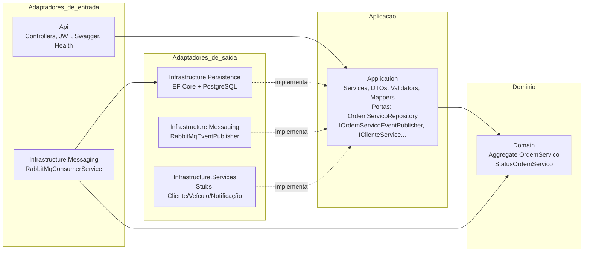
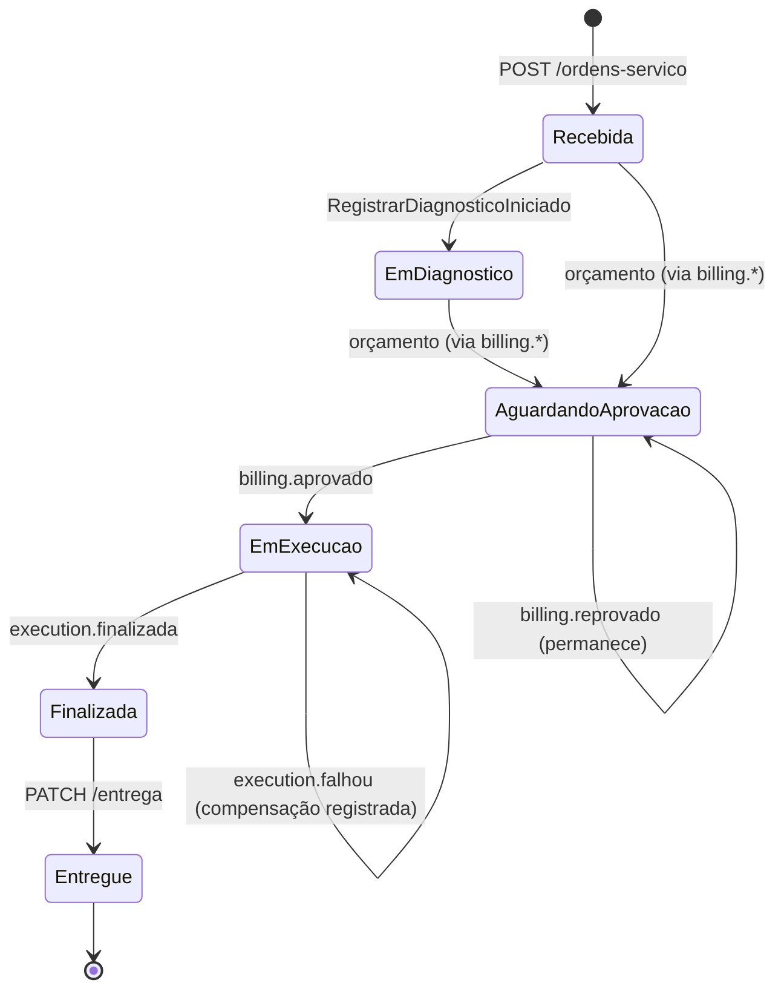
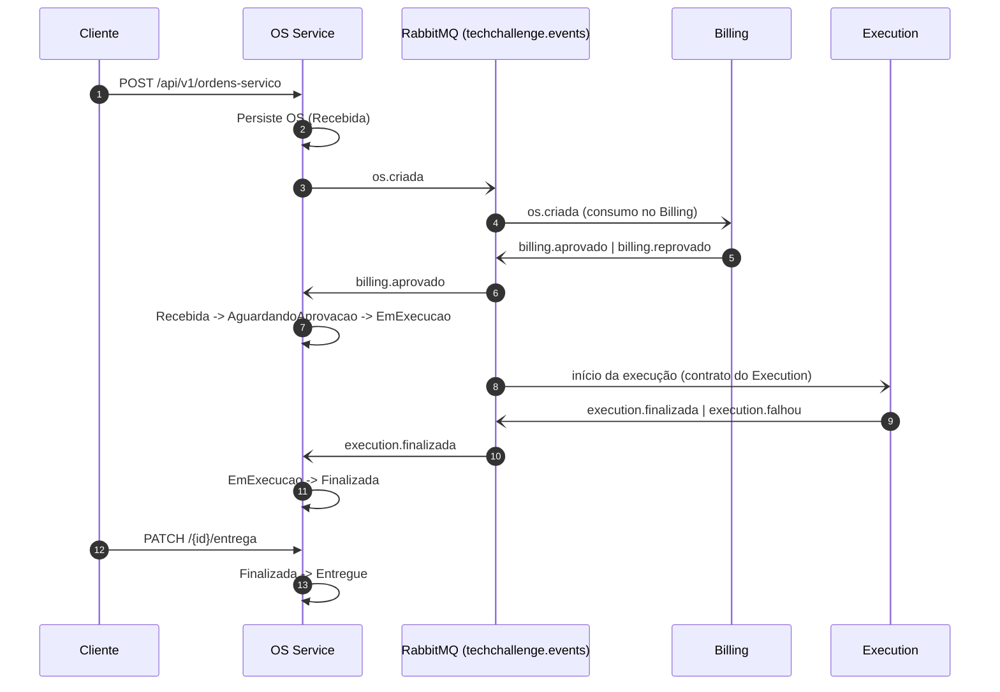

# TechChallenge.OS — Microsserviço de Ordens de Serviço

Entrega da **Fase 4** do Tech Challenge FIAP — PósTech Arquitetura de Software.

Este repositório contém o **OS Service**, um dos três microsserviços independentes da solução (**OS**, **Billing** e **Execution**) que se coordenam por uma **Saga coreografada** sobre RabbitMQ.

> **Convenção deste documento:** só está descrito como "implementado" o que foi verificado no código deste repositório. O que não existe, ou depende de outros repositórios/ambientes não verificados aqui, aparece como **pendente** ou **não verificado** (resumo na seção [22](#22-decisões-arquiteturais-e-limitações-conhecidas)).

## Sumário

1. [Visão geral e responsabilidades](#1-visão-geral-e-responsabilidades)
2. [Arquitetura e organização do código](#2-arquitetura-e-organização-do-código)
3. [Tecnologias utilizadas](#3-tecnologias-utilizadas)
4. [Estrutura de diretórios](#4-estrutura-de-diretórios)
5. [Pré-requisitos](#5-pré-requisitos)
6. [Configuração das variáveis de ambiente](#6-configuração-das-variáveis-de-ambiente)
7. [Como executar localmente](#7-como-executar-localmente)
8. [Como executar com Docker Compose](#8-como-executar-com-docker-compose)
9. [Swagger e endpoints REST](#9-swagger-e-endpoints-rest)
10. [Persistência PostgreSQL e migrations](#10-persistência-postgresql-e-migrations)
11. [Estados da OS e regras de transição](#11-estados-da-os-e-regras-de-transição)
12. [Eventos RabbitMQ publicados e consumidos](#12-eventos-rabbitmq-publicados-e-consumidos)
13. [Participação na Saga coreografada](#13-participação-na-saga-coreografada)
14. [Fluxo de sucesso e tratamento de falhas](#14-fluxo-de-sucesso-e-tratamento-de-falhas)
15. [Idempotência, consistência e compensação](#15-idempotência-consistência-e-compensação)
16. [Autenticação JWT e bypass de desenvolvimento](#16-autenticação-jwt-e-bypass-de-desenvolvimento)
17. [Testes automatizados e cobertura](#17-testes-automatizados-e-cobertura)
18. [CI/CD com GitHub Actions](#18-cicd-com-github-actions)
19. [Análise de qualidade (SonarQube/SonarCloud)](#19-análise-de-qualidade-sonarqubesonarcloud)
20. [Kubernetes](#20-kubernetes)
21. [Observabilidade e monitoramento](#21-observabilidade-e-monitoramento)
22. [Decisões arquiteturais e limitações conhecidas](#22-decisões-arquiteturais-e-limitações-conhecidas)

---

## 1. Visão geral e responsabilidades

O OS Service gerencia o ciclo de vida das ordens de serviço (OS) de uma oficina mecânica.

**É responsável por:**

- Abrir OS (cliente, veículo, itens de serviço e de peça/insumo como *snapshot* da solicitação inicial) e atribuir número sequencial e `UniqueCode` (Guid) de rastreamento.
- Consultar OS por id, por `UniqueCode` e listar OS ativas.
- Registrar a entrega do veículo (`Finalizada → Entregue`) e a exclusão lógica da OS.
- Publicar `os.criada` após persistir a OS.
- Consumir eventos de Billing e Execution e refletir o resultado no estado da OS (idempotente).
- Registrar a compensação persistida quando a Execution informa falha (`execution.falhou`).

**Não é responsável por** (pertence a outros serviços): orçamento/aprovação financeira (Billing), execução técnica do serviço (Execution) e cadastro de clientes/veículos. O OS Service **não acessa bancos de outros serviços**.

> Cliente, veículo e notificação são **stubs** (`ClienteServiceStub`, `VeiculoServiceStub`, `NotificacaoServiceStub`): sempre retornam "existe/pertence" e dados fictícios. Não há integração real com um serviço de cadastro.

## 2. Arquitetura e organização do código

DDD com Arquitetura Hexagonal (Ports & Adapters). A dependência aponta sempre para dentro:



| Projeto | Camada | Conteúdo |
|---|---|---|
| `TechChallenge.OS.Domain` | Domínio | Aggregate Root `OrdemServico`, itens, enum `StatusOrdemServico`, `DomainException`. Sem dependências externas. |
| `TechChallenge.OS.Application` | Aplicação | `OrdemServicoApplicationService` (casos de uso), DTOs, validadores, mapeadores, portas (interfaces). |
| `TechChallenge.OS.Infrastructure` | Adaptadores de saída/entrada assíncrona | `OSDbContext`, repositório, migrations, publisher/consumer RabbitMQ, stubs, `DependencyInjection`. |
| `TechChallenge.OS.Api` | Adaptador de entrada HTTP | Controller REST, JWT, Swagger, `GlobalExceptionHandler`, health check. |
| `TechChallenge.OS.UnitTests` | Testes | Testes unitários, de API/JWT e de integração com PostgreSQL. |

Pontos relevantes:

- A publicação de `os.criada` é feita por um **decorator** (`PublishingOrdemServicoApplicationService`) sobre o serviço de aplicação, sem alterar a camada Application.
- O consumidor (`IntegrationEventHandler`) aplica eventos usando apenas os métodos de transição já existentes no Domain.

## 3. Tecnologias utilizadas

| Tecnologia | Uso | Versão (verificada nos `.csproj`/Dockerfile) |
|---|---|---|
| .NET / C# | Plataforma | `net10.0` (imagens `sdk:10.0` e `aspnet:10.0`) |
| ASP.NET Core | API REST, `BackgroundService`, health checks | 10.0 |
| Entity Framework Core + Npgsql | Persistência e migrations | 10.0.x |
| PostgreSQL | Banco do serviço | 16 (compose e CI) |
| RabbitMQ (`RabbitMQ.Client`) | Mensageria da Saga | broker `rabbitmq:4.2.9-management` no CI |
| JWT Bearer | Autenticação | `Microsoft.AspNetCore.Authentication.JwtBearer` 10.0.14 |
| Swashbuckle | Swagger/OpenAPI | 10.3.1 |
| xUnit, Moq, coverlet | Testes e cobertura | xUnit 2.9.3, Moq 4.20.70, coverlet.collector 6.0.4 |
| Docker / Docker Compose | Empacotamento e execução local | — |
| GitHub Actions | CI/CD | ver [seção 18](#18-cicd-com-github-actions) |

## 4. Estrutura de diretórios

```text
.
├── .github/workflows/os-ci-cd.yml      # Pipeline CI/CD
├── .specs/features/ci-cd/spec.md       # Estória e procedimento de implantação do pacote
├── docs/                               # Documentação das entregas anteriores
├── scripts/Write-TestSummary.ps1       # Validação/resumo dos resultados de teste (CI)
├── tests/coverage.runsettings          # Configuração de cobertura (cobertura + opencover)
├── src/
│   ├── TechChallenge.OS.Api/           # Controllers, Program.cs, Middleware, HealthChecks
│   ├── TechChallenge.OS.Application/   # Services, DTOs, Validators, Mappers, Interfaces
│   ├── TechChallenge.OS.Domain/        # Aggregates, Enums, Exceptions
│   ├── TechChallenge.OS.Infrastructure/# Persistence, Migrations, Messaging, Repositories, Services (stubs)
│   └── TechChallenge.OS.UnitTests/     # Domain, Application, Api, Messaging, Integration
├── Dockerfile
├── docker-compose.yml                  # API + PostgreSQL (RabbitMQ externo)
├── docker-compose.test.yml             # PostgreSQL para testes de integração
├── docker-compose.integration.yml      # PostgreSQL para testes de integração (mesmo conteúdo do .test.yml)
└── TechChallenge.OS.slnx
```

## 5. Pré-requisitos

- [.NET SDK 10](https://dotnet.microsoft.com/download) (`dotnet --version`).
- Docker e Docker Compose (para PostgreSQL e/ou execução containerizada).
- PostgreSQL 16 e RabbitMQ acessíveis (local, via Docker, ou compartilhado com a Execution — ver seção 8).
- Ferramenta `dotnet-ef` para aplicar migrations manualmente: `dotnet tool install --global dotnet-ef --version 10.0.14`.

## 6. Configuração das variáveis de ambiente

Use `__` para chaves aninhadas do `appsettings` (ex.: `Jwt__Issuer`). **Nunca versione segredos reais**; os valores abaixo são exemplos locais.

| Variável | Obrigatória | Padrão / exemplo | Descrição |
|---|---|---|---|
| `ConnectionStrings__OSDb` | Sim* | `Host=localhost;Port=5432;Database=techchallenge_os;Username=postgres;Password=<senha>` | Connection string PostgreSQL. |
| `OSDB_CONNECTION_STRING` | Alternativa | — | Usada se `ConnectionStrings:OSDb` não estiver definida. |
| `Jwt__Issuer` | Sim | `__SET_FROM_AUTH_SERVICE__` (placeholder) | Emissor esperado nos tokens. |
| `Jwt__Audience` | Sim | idem | Audiência esperada. |
| `Jwt__SigningKey` | Sim | idem | Chave simétrica HS256 (use ≥ 32 bytes). |
| `Authentication__BypassEnabled` | Não | `false` | Bypass de autorização; **só tem efeito em `Development`** (seção 16). |
| `ASPNETCORE_ENVIRONMENT` | Não | `Development` (launchSettings) | Ambiente. |
| `ASPNETCORE_URLS` | Não | `http://+:8080` (Dockerfile) | Endereço de escuta. |
| `RABBITMQ_ENABLED` | Não | `true` | `false` troca publisher/consumer por implementação nula (nenhuma mensagem é publicada/consumida). |
| `RABBITMQ_HOST` / `RABBITMQ_PORT` | Não | `localhost` / `5672` | Broker. |
| `RABBITMQ_USER` / `RABBITMQ_PASSWORD` | Não | `guest` / `guest` | Credenciais (padrão do RabbitMQ local). |
| `RABBITMQ_VHOST` | Não | `/` | Virtual host. |
| `RABBITMQ_QUEUE` | Não | `os-service.events` | Fila de consumo do OS. |

\* A aplicação lança exceção na inicialização se a connection string ou o trio `Jwt` estiver ausente/vazio.

> Atenção: `appsettings.json` traz o placeholder `__SET_FROM_AUTH_SERVICE__` para o JWT. Ele é um valor não vazio, então a API sobe, mas **nenhum token real será validado** até que os valores corretos sejam informados.

## 7. Como executar localmente

```powershell
# 1) Infraestrutura local (PostgreSQL e RabbitMQ)
docker run -d --name os-postgres -e POSTGRES_DB=techchallenge_os_dev -e POSTGRES_USER=postgres -e POSTGRES_PASSWORD=postgres -p 5432:5432 postgres:16
docker run -d --name os-rabbit -p 5672:5672 -p 15672:15672 rabbitmq:4-management

# 2) Configuração mínima (valores de exemplo para uso local)
$env:Jwt__Issuer     = "os-local"
$env:Jwt__Audience   = "os-local"
$env:Jwt__SigningKey = "chave-local-com-no-minimo-32-bytes-123"

# 3) Migrations
dotnet tool install --global dotnet-ef --version 10.0.14
dotnet ef database update -p src/TechChallenge.OS.Infrastructure -s src/TechChallenge.OS.Api

# 4) Executar a API (perfil http: http://localhost:5000)
dotnet run --project src/TechChallenge.OS.Api --launch-profile http
```

- `appsettings.Development.json` aponta para `Host=localhost;Port=5432;Database=techchallenge_os_dev;Username=postgres;Password=postgres`.
- Sem RabbitMQ disponível, defina `$env:RABBITMQ_ENABLED = "false"`. Com `true` e broker fora do ar, o consumidor registra erro e tenta reconectar a cada 5 s, e a criação de OS continua funcionando (a falha de publicação é apenas logada).
- Health check: `Invoke-RestMethod http://localhost:5000/health` → `Healthy`.

## 8. Como executar com Docker Compose

O [docker-compose.yml](docker-compose.yml) sobe a **API** (`localhost:8081` → container `8080`) e o **PostgreSQL** (`localhost:5433` → `5432`, volume `postgres_os_data`).

**Dependência importante:** o compose **não define o RabbitMQ**. A API usa `RABBITMQ_HOST=rabbitmq` e entra na rede Docker **externa** `tech-challenge-execution-service_default`, que precisa existir (criada pelo compose do repositório da Execution, que deve expor um serviço chamado `rabbitmq`). Sem essa rede, `docker compose up` falha.

```powershell
# Rede externa (se o compose da Execution ainda não a criou). Você ainda precisa de um RabbitMQ
# com o alias "rabbitmq" nessa rede.
docker network create tech-challenge-execution-service_default

docker compose up --build -d
docker compose ps
Invoke-RestMethod http://localhost:8081/health
```

Observações verificadas no compose:

- Ele define `ASPNETCORE_ENVIRONMENT=Development` e `Authentication__BypassEnabled=true` — ou seja, **autenticação desativada**; é configuração de desenvolvimento, não de produção.
- JWT usa valores `changeme` (somente exemplo local).
- **As migrations não são aplicadas automaticamente** (não há `Migrate()` no startup). Aplique-as no banco do compose antes de usar a API:

```powershell
dotnet ef database update -p src/TechChallenge.OS.Infrastructure -s src/TechChallenge.OS.Api `
  --connection "Host=localhost;Port=5433;Database=techchallenge_os;Username=postgres;Password=postgres"
```

Para encerrar: `docker compose down` (adicione `-v` para apagar o volume do banco).

## 9. Swagger e endpoints REST

Swagger UI: `/swagger` (ex.: `http://localhost:5000/swagger` local; `http://localhost:8081/swagger` no compose). O Swagger está habilitado **em todos os ambientes** (não é restrito a Development) e define o esquema `Bearer` (JWT).

Todos os endpoints exigem `[Authorize]`. Rota base: `/api/v1/ordens-servico`.

| Método | Rota | Descrição | Respostas |
|---|---|---|---|
| `POST` | `/api/v1/ordens-servico` | Cria OS (status `Recebida`) e publica `os.criada` | 201, 400 |
| `GET` | `/api/v1/ordens-servico` | Lista OS ativas | 200 |
| `GET` | `/api/v1/ordens-servico/{id}` | Obtém OS por id | 200, 404 |
| `GET` | `/api/v1/ordens-servico/por-codigo/{uniqueCode}` | Consulta por `UniqueCode` (Guid) | 200, 404 |
| `PATCH` | `/api/v1/ordens-servico/{id}/entrega` | `Finalizada → Entregue` | 200, 404, 409 |
| `DELETE` | `/api/v1/ordens-servico/{id}` | Exclusão lógica (`Ativo = false`) | 204, 404, 409 |
| `GET` | `/health` | Health check (sem `[Authorize]`; verifica PostgreSQL) | 200 / 503 |

Mapeamento de erros (`GlobalExceptionHandler`): `NotFoundException` → 404; `InvalidOperationException` (inclui transição inválida) → 409; `ApplicationException` → 400; demais → 500.

Exemplo (PowerShell):

```powershell
$base  = "http://localhost:8081"
$token = "<JWT>"   # omita o header se o bypass de Development estiver ativo
$h = @{ Authorization = "Bearer $token" }

$body = @{
  clienteId = 1; veiculoId = 1
  itensServicos = @(@{ servicoId = 10; descricao = "Troca de óleo" })
  itensPecasInsumos = @(@{ pecaInsumoId = 5; descricao = "Filtro de óleo"; quantidade = 1 })
} | ConvertTo-Json -Depth 5

$os = Invoke-RestMethod -Method Post -Uri "$base/api/v1/ordens-servico" -Headers $h -ContentType "application/json" -Body $body
$os.uniqueCode

Invoke-RestMethod "$base/api/v1/ordens-servico/por-codigo/$($os.uniqueCode)" -Headers $h
Invoke-RestMethod -Method Patch "$base/api/v1/ordens-servico/$($os.id)/entrega" -Headers $h   # 409 se não estiver Finalizada
```

Há também o arquivo [TechChallenge.OS.Api.http](src/TechChallenge.OS.Api/TechChallenge.OS.Api.http) para testes manuais.

## 10. Persistência PostgreSQL e migrations

Banco próprio do serviço (`OSDbContext`, Npgsql). Tabelas:

| Tabela | Finalidade |
|---|---|
| `ordem_servico` | Agregado OS (status, `unique_code`, cliente/veículo, auditoria, `ativo`). |
| `ordem_servico_item_servico` | Itens de serviço (snapshot). |
| `ordem_servico_item_peca_insumo` | Itens de peça/insumo (snapshot). |
| `processed_event` | Idempotência: PK = `event_id`. |
| `ordem_servico_compensacao` | Compensações pendentes; índice único por `ordem_servico_unique_code`. |

Migrations (`src/TechChallenge.OS.Infrastructure/Migrations`): `20261116194129_InitialCreate` e `20261117005145_AddMessagingTables`.

```powershell
# Aplicar
dotnet ef database update -p src/TechChallenge.OS.Infrastructure -s src/TechChallenge.OS.Api

# Nova migration
dotnet ef migrations add NomeDaMigration -p src/TechChallenge.OS.Infrastructure -s src/TechChallenge.OS.Api

# Script SQL idempotente (o mesmo que o CI gera)
dotnet ef migrations script --idempotent -p src/TechChallenge.OS.Infrastructure -s src/TechChallenge.OS.Api -o migrations.sql
```

As migrations são aplicadas **manualmente** (CLI ou `migrations.sql` do pacote de entrega). No CI elas são aplicadas em um PostgreSQL efêmero apenas para validação.

## 11. Estados da ordem de serviço e regras de transição

Enum `StatusOrdemServico`: `Recebida (1)`, `EmDiagnostico (2)`, `AguardandoAprovacao (3)`, `EmExecucao (4)`, `Finalizada (5)`, `Entregue (6)`.



Regras (Domain):

- Itens só podem ser adicionados com a OS em `Recebida`.
- `Recebida → EmDiagnostico` existe no Domain (`RegistrarDiagnosticoIniciado`), mas **nenhum evento consumido hoje o aciona**.
- `AguardandoAprovacao → EmExecucao` só a partir de `AguardandoAprovacao`; `EmExecucao → Finalizada` só a partir de `EmExecucao`; `Entregue` só a partir de `Finalizada`.
- Transição inválida lança `InvalidOperationException` (HTTP 409 na API; no consumidor, mensagem vai para a fila de erro).
- Não existe estado de cancelamento/falha: `billing.reprovado` e `execution.falhou` **não alteram o `Status`** (ver seção 14).
- `Delete()` é exclusão lógica permitida em qualquer estado; OS inativas não são encontradas pelo consumidor.

## 12. Eventos RabbitMQ publicados e consumidos

Exchange `topic` durável: **`techchallenge.events`**. Payload JSON camelCase com o contrato comum:

```json
{
  "eventId": "00000000-0000-0000-0000-000000000000",
  "ordemServicoUniqueCode": "00000000-0000-0000-0000-000000000000",
  "occurredAt": "2026-11-17T12:00:00Z",
  "motivo": "opcional (usado em execution.falhou; truncado em 500 caracteres)"
}
```

| Direção | Routing key | Significado | Efeito no OS |
|---|---|---|---|
| Publica | `os.criada` | OS criada e persistida | — (mensagem persistente, com publisher confirms, `messageId = eventId`) |
| Consome | `billing.aprovado` | Orçamento aprovado | OS → `AguardandoAprovacao` (se `Recebida`/`EmDiagnostico`) → `EmExecucao` |
| Consome | `billing.reprovado` | Orçamento reprovado | OS → `AguardandoAprovacao` e permanece |
| Consome | `execution.finalizada` | Execução concluída | `EmExecucao → Finalizada` |
| Consome | `execution.falhou` | Falha ao criar/executar | Registra compensação; `Status` permanece `EmExecucao` |

Topologia (declarada pelo consumidor na inicialização):

- Fila durável `os-service.events` ligada às 4 routing keys consumidas, com dead-letter exchange `techchallenge.events.os.error` (direct, routing key `os.error`).
- Fila de erro durável `os-service.events.error`.
- `prefetch = 1`, `ack` manual.

## 13. Participação na Saga coreografada

Não há orquestrador: cada serviço reage a eventos e publica os seus.



> **Não verificado neste repositório:** quem consome `os.criada` e quem reage a `billing.aprovado` na Execution estão nos repositórios Billing/Execution. O OS Service garante apenas o seu lado (publicar `os.criada`; consumir as 4 routing keys acima).

## 14. Fluxo de sucesso e tratamento de falhas

**Sucesso:** `os.criada` → `billing.aprovado` (OS vai a `EmExecucao`) → `execution.finalizada` (OS `Finalizada`) → entrega via REST (`Entregue`).

| Situação | Comportamento implementado | Estado final da OS |
|---|---|---|
| `billing.reprovado` | Valida/leva a `AguardandoAprovacao` e mantém. Não há cancelamento automático. | `AguardandoAprovacao` |
| `execution.falhou` com OS `EmExecucao` | Grava `ordem_servico_compensacao` (`Status = Pendente`, motivo, eventId) e marca o evento como processado. **Não publica evento de compensação e não muda o `Status`.** | `EmExecucao` (bloqueada para progressão) |
| Qualquer evento (≠ `execution.falhou`) para OS com compensação | Rejeitado como erro permanente → fila de erro. | Inalterado |
| `execution.falhou` com OS fora de `EmExecucao` | Transição inválida → fila de erro. | Inalterado |
| Evento duplicado (`eventId` já processado) | Ignorado (log) e confirmado com ACK. | Inalterado |
| JSON inválido, campos obrigatórios ausentes, routing key desconhecida, OS inexistente/inativa, transição inválida | `PermanentMessageException` → `nack` sem requeue → `os-service.events.error`. | Inalterado |
| Falha transitória (ex.: banco indisponível) | Até 3 tentativas locais (espera 2 s, 4 s); esgotadas → `nack` sem requeue → fila de erro. | Inalterado |
| Parada do consumidor durante o processamento | `nack` com requeue. | Inalterado |
| Broker indisponível ao criar OS | Erro logado; **a OS permanece criada e `os.criada` não é entregue** (sem retry/outbox). | `Recebida` |
| Conexão do consumidor cai | Reconexão automática a cada 5 s. | — |

## 15. Idempotência, consistência e compensação

- **Idempotência:** o `eventId` é a chave primária de `processed_event`. O handler consulta antes de aplicar e grava o registro **na mesma transação** (`SaveChanges` único) que a mudança de estado/compensação. Reentregas são ignoradas.
- **Consistência:** *at-least-once* no consumo (ACK só após gravar no banco) + idempotência = efeito exato na prática. Entre a OS e o evento `os.criada` há consistência **eventual e sem garantia**: não existe *Transactional Outbox* — se o processo cair após o commit e antes da publicação, o evento é perdido.
- **Compensação:** na falha da Execution, o OS persiste a pendência de compensação e **trava** a OS (qualquer outro evento é rejeitado), evitando progressão indevida. O tratamento da compensação em si (ex.: cancelar OS, estornar/cancelar orçamento no Billing, reprocessar) **não está implementado**: `Status` da compensação nunca sai de `Pendente`, nenhum evento de compensação é publicado e não há endpoint para resolvê-la.
- **Falhas permanentes** ficam na fila `os-service.events.error` para análise manual; não há reprocessamento automatizado.

## 16. Autenticação JWT e bypass de desenvolvimento

- A API valida JWT Bearer (HS256) com `ValidateIssuer`, `ValidateAudience`, `ValidateLifetime`, `ValidateIssuerSigningKey` e `ClockSkew = 0`, usando `Jwt:Issuer`, `Jwt:Audience` e `Jwt:SigningKey`.
- O OS Service **não emite tokens**; o emissor é um serviço de autenticação externo, que deve usar os mesmos valores.
- O controller é `[Authorize]`; `/health` é público.

**Bypass (somente `Development`):** se `ASPNETCORE_ENVIRONMENT=Development` **e** `Authentication:BypassEnabled=true`, a política padrão de autorização passa a aceitar qualquer requisição (`RequireAssertion(_ => true)`), dispensando o token. Fora de `Development` a flag é ignorada (a condição exige `IsDevelopment()`).

> O `docker-compose.yml` atual usa `Development` + bypass ligado. **Não reutilize essa configuração em ambientes compartilhados ou produção.** Para exercitar JWT no compose, remova `Authentication__BypassEnabled` ou use `ASPNETCORE_ENVIRONMENT=Production`.

## 17. Testes automatizados e cobertura

Projeto: `src/TechChallenge.OS.UnitTests` (xUnit, Moq, `Microsoft.AspNetCore.Mvc.Testing`). Há 74 métodos `[Fact]/[Theory]` declarados, distribuídos em:

| Área | Arquivo(s) |
|---|---|
| Domínio | `Domain/OrdemServicoTests.cs` |
| Aplicação | `Application/*` (serviço, validator, mapper) |
| API/controller | `Api/Controllers/OrdemServicoControllerTests.cs` |
| JWT (HTTP) | `Api/Authentication/JwtAuthenticationIntegrationTests.cs` |
| Mensageria | `Messaging/MessagingTests.cs` (validação de mensagens e decorator de publicação) |
| Integração PostgreSQL | `Integration/OrdemServicoRepositoryIntegrationTests.cs` |

```powershell
# Todos os testes de unidade (sem exigir PostgreSQL)
dotnet test src/TechChallenge.OS.UnitTests --filter "FullyQualifiedName!~.Integration.&FullyQualifiedName!~.Api.Authentication."

# Integração com PostgreSQL (porta 5433)
docker compose -f docker-compose.test.yml up -d
$env:RUN_POSTGRES_INTEGRATION_TESTS = "true"
$env:OSDB_INTEGRATION_TEST_CONNECTION = "Host=127.0.0.1;Port=5433;Database=techchallenge_os_test;Username=postgres;Password=postgres"
dotnet test src/TechChallenge.OS.UnitTests --filter "FullyQualifiedName~.Integration.|FullyQualifiedName~.Api.Authentication."

# Com cobertura (gera cobertura e opencover)
dotnet test src/TechChallenge.OS.UnitTests --collect "XPlat Code Coverage" --settings tests/coverage.runsettings
```

**Cobertura:** a coleta está configurada (`tests/coverage.runsettings`: formatos `cobertura` e `opencover`, inclui `[TechChallenge.OS.*]*`), e o CI publica os relatórios como artefatos. **Este README não declara um percentual**: o valor deve ser consultado nos artefatos do CI ou no SonarQube.

Lacunas conhecidas: não há teste ponta a ponta com RabbitMQ real nem testes do consumidor com banco (os testes de mensageria cobrem apenas rejeições de mensagens inválidas e o decorator); o fluxo de compensação não possui teste automatizado dedicado.

## 18. CI/CD com GitHub Actions

Workflow: [.github/workflows/os-ci-cd.yml](.github/workflows/os-ci-cd.yml) — dispara em *push* e *pull request* para a branch **`feat/developtment`** e em `workflow_dispatch`. (Não há gatilho para `main`/`master`.)

| Job | O que faz |
|---|---|
| `01 - Restore e build` | `dotnet restore` e `dotnet build` em Release com `--warnaserror` (exceto CS1591). |
| `02 - Testes` (matriz) | Suíte **unitária** e suíte de **integração HTTP/JWT + PostgreSQL 16**; coleta cobertura; `Write-TestSummary.ps1` valida/resume; publica TRX e cobertura (14 dias). |
| `SonarQube` | Condicional (ver seção 19). |
| `03 - Publicar e validar artefato` | Somente em *push* na `feat/developtment`: `dotnet publish`, gera e aplica migrations idempotentes em PostgreSQL efêmero, sobe a API publicada com PostgreSQL e RabbitMQ efêmeros, valida `/health` = `Healthy` e a presença do consumidor na fila `os-service.events`, e publica `os-service-feat-developtment.tar.gz` + SHA256 (30 dias). |

**Escopo real:** o pipeline realiza **CI e empacotamento**. **Não há** build/push de imagem Docker, nem deploy automático em Kubernetes ou em outro ambiente; a entrega é um pacote para implantação manual (procedimento e rollback em [.specs/features/ci-cd/spec.md](.specs/features/ci-cd/spec.md)). Resultados de execuções devem ser consultados na aba **Actions**; este README não afirma o status atual.

## 19. Análise de qualidade (SonarQube/SonarCloud)

O job **SonarQube** está configurado no workflow, mas é **opcional/condicional**: só executa se a variável de repositório `SONAR_PROJECT_KEY` estiver definida (além de não ser *dependabot* nem PR de fork). Requer:

1. Secret `SONAR_TOKEN`.
2. Variável `SONAR_ORGANIZATION` (SonarQube Cloud; opcionalmente `SONAR_REGION=us`) **ou** `SONAR_HOST_URL` (Server).
3. Variável `SONAR_PROJECT_KEY` (por último, pois ela ativa o job).

O job usa o SonarScanner for .NET 12.1.0, importa a cobertura OpenCover e os TRX gerados pelos testes e **aguarda o Quality Gate** (`sonar.qualitygate.wait=true`). Se a configuração está efetivamente feita no repositório e qual o resultado do Quality Gate **não é verificável a partir do código**; consulte o job no Actions e o dashboard do Sonar. Análise de branches e PRs depende do plano do Sonar ([planos](https://docs.sonarsource.com/sonarqube-cloud/administering-sonarcloud/managing-subscription/subscription-plans)).

## 20. Kubernetes

**Não implementado neste repositório.** Não existem manifests (`k8s/`), Helm charts, nem etapa de deploy em cluster no workflow. Portanto este README **não** afirma suporte nem deploy funcional em Kubernetes. Ver pendências.

## 21. Observabilidade e monitoramento

Implementado:

- **Logs** via `ILogger` (nível padrão `Information`, `Microsoft.AspNetCore` em `Warning`), com `EventId`, `RoutingKey`, `OS` e `Status` nas mensagens de mensageria; erros de consumo e de publicação são registrados.
- **Health check** `GET /health`: valida somente a conexão com o PostgreSQL (`DatabaseHealthCheck`). **Não** inclui o estado do RabbitMQ.
- Console do RabbitMQ (porta 15672 quando usando a imagem `-management`) para inspecionar filas, consumidores e a fila `os-service.events.error`.
- No CI, o smoke test confirma o consumidor ativo via `rabbitmqctl list_queues`.

Não implementado: métricas (Prometheus/OpenTelemetry), tracing distribuído, correlação de logs entre serviços, logs estruturados com *sink* centralizado e alertas (inclusive para a fila de erro e para compensações `Pendente`).

## 22. Decisões arquiteturais e limitações conhecidas

**Decisões**

- Saga **coreografada** (sem orquestrador), com exchange `topic` única `techchallenge.events` e fila exclusiva por serviço.
- Domain e Application permanecem inalterados pela mensageria; integração isolada na Infrastructure (decorator para publicar, handler para consumir).
- Idempotência e mudança de estado na mesma transação; mensagens irrecuperáveis vão para DLQ em vez de reentrega infinita.
- Como não há eventos de "orçamento gerado"/"execução iniciada", `billing.aprovado` encadeia `→ AguardandoAprovacao → EmExecucao`.
- Banco próprio (*database per service*); cliente/veículo/notificação por portas com stubs.

**Limitações conhecidas**

- Sem *Transactional Outbox*: `os.criada` pode ser perdido (broker fora ou falha após commit).
- Compensação apenas registrada (`Pendente`) e bloqueante; sem cancelamento da OS, sem evento de compensação e sem endpoint/rotina de resolução.
- Sem estado de cancelamento/falha na OS; `billing.reprovado` mantém a OS em `AguardandoAprovacao`.
- Fila de erro sem reprocessamento automático.
- Cliente/Veículo/Notificação são stubs.
- Migrations não são aplicadas automaticamente; o compose depende de rede e RabbitMQ externos (repositório Execution) e roda com bypass de autenticação.
- Swagger habilitado em todos os ambientes; `appsettings` com placeholders de JWT.
- `UseHttpsRedirection` está ativo e o container expõe apenas HTTP (porta 8080).
- Pipeline limitado à branch `feat/developtment`; sem imagem Docker publicada e sem deploy automatizado.
- Sem contrato formal (schema) versionado dos eventos compartilhado com Billing/Execution.

## Pendências em relação à Fase 4 (resumo)

- [ ] Manifests Kubernetes e deploy automatizado (inexistentes) — e evidência de deploy funcional.
- [ ] Build/publicação de imagem Docker no CI.
- [ ] Evidência da execução da Saga completa (OS + Billing + Execution) com RabbitMQ real.
- [ ] Implementar a resolução da compensação (cancelamento da OS/evento de compensação).
- [ ] Transactional Outbox para `os.criada`.
- [ ] Confirmar a configuração do SonarQube/Cloud e registrar o resultado do Quality Gate e a cobertura.
- [ ] Observabilidade: métricas, tracing e alertas; health check incluindo RabbitMQ.
- [ ] Gatilhos do CI para a branch principal e substituição dos stubs por integrações reais.
